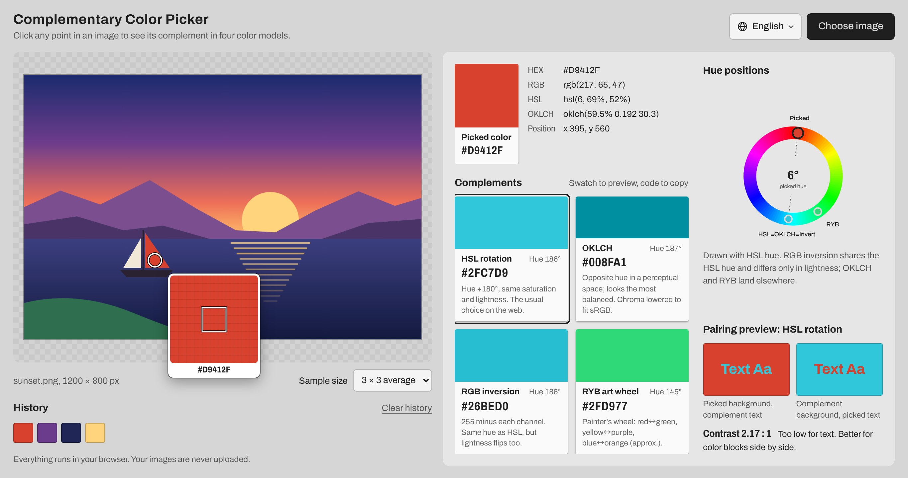
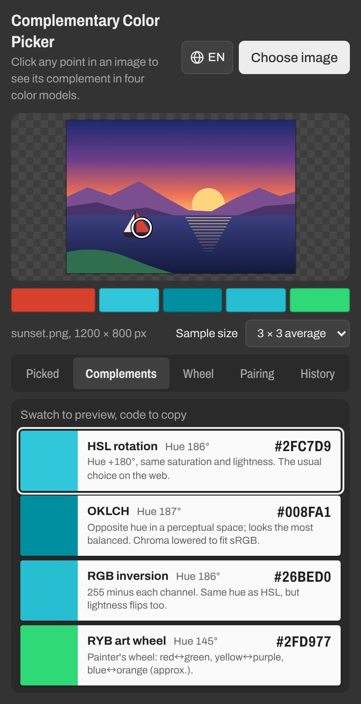

<p align="center">
  <a href="README.md">繁體中文</a> ｜
  <a href="README.zh-Hans.md">简体中文</a> ｜
  <b>English</b> ｜
  <a href="README.ja.md">日本語</a>
</p>

<h1 align="center">Complementary Color Picker</h1>

<p align="center">
  Load an image, click the color you want, and see its complement instantly.<br>
  Nothing to install and no sign-up. Just open the page on your computer or phone.
</p>

<p align="center">
  <a href="https://remon2208.github.io/complementary-color-picker/?lang=en">
    
  </a>
</p>

<p align="center">
  Website: <a href="https://remon2208.github.io/complementary-color-picker/?lang=en"><b>https://remon2208.github.io/complementary-color-picker/</b></a>
</p>

<p align="center">
  <a href="https://remon2208.github.io/complementary-color-picker/?lang=en">
    <picture>
      <source media="(prefers-color-scheme: dark)" srcset="docs/en/dark.jpg">
      
    </picture>
  </a>
</p>

## How to use

1. Open the link above
2. Click **Choose image** in the top-right corner, drag an image onto the page, or copy a screenshot and paste it with Ctrl+V (⌘V on Mac)
3. Click the color you want in the image, and its complements appear next to it
4. Click a color code (for example `#2FC7D9`) to copy it, then paste it into your design tool or code



**Tips**

- Move the mouse over the image to get a magnifier for lining up a single pixel
- For noisy photos, set **Sample size** to 5 × 5 or 9 × 9 average for a steadier color
- Hold the mouse button and drag across the image to watch the results as you move
- Colors you pick stay in **History**. Click one to bring it back
- On a phone, switch between results with the tabs: Picked, Complements, Wheel, Pairing and History
- Change the language in the top-right corner (繁體中文, 简体中文, English, 日本語). Your choice is remembered next time

## How the four complements differ

The page works out the complement four ways at once, so you can pick the one that fits:

| Method | Best for |
| --- | --- |
| **HSL rotation** | The usual complement for websites and app interfaces |
| **OKLCH** | Two colors that feel equally balanced |
| **RGB inversion** | Strong contrast where lightness flips too |
| **RYB art wheel** | Painting and mixing paint: red with green, yellow with purple, blue with orange |

The **Pairing preview** puts the two colors side by side and tells you whether the contrast is high enough for text.

<br clear="right">

## FAQ

**Are my images uploaded anywhere?**
No. Everything runs in your own browser, and your images never leave your computer or phone.

**My iPhone photos won't open.**
The iPhone's default HEIC format only opens in Safari. In other browsers, convert the photo to JPG or PNG first.

**The picked color is slightly different from my photo editor.**
The page reads the color after your browser converts it to standard screen color (sRGB). Wide-gamut photos, such as those from an iPhone, can show small differences.

**Why don't gray, black and white have complements?**
These colors have no hue, so there's no true complement. The page shows a note when this happens.

**I still see the old version.**
Press Ctrl+F5 (⌘ + Shift + R on Mac) to force a refresh.

---

<details>
<summary><b>For developers: how it works and deploying your own copy</b></summary>

### Overview

Plain HTML, CSS and JavaScript with no packages and no build step. Open `index.html` in a browser to run it locally.

```
├── index.html          Page structure
├── style.css           Styles
├── color.js            Complement algorithms (no DOM; also works in Node.js)
├── i18n.js             UI text and language switching (zh-Hant, zh-Hans, en, ja)
├── app.js              UI logic: loading images, picking, magnifier, results
├── docs/               Screenshots for the README (one folder per language)
└── tests/
    ├── color.test.js   Algorithm tests
    └── i18n.test.js    Translation checks: every language has every string and the same parameters
```

### Algorithms

| Method | How it works |
| --- | --- |
| HSL rotation | Hue +180°, saturation and lightness unchanged |
| OKLCH | Negate a and b in OKLab (the same as hue +180°), lightness unchanged |
| RGB inversion | `255 − value` for each channel. Same hue as HSL, but lightness flips too |
| RYB art wheel | Map the RGB hue piecewise onto a red-yellow-blue wheel, rotate 180°, map back (approximate) |

HSL rotation has a shortcut that skips the color-space conversion:

```
new = max(R, G, B) + min(R, G, B) − old
```

For example `#3366CC` → `#CC9933` and `#800000` → `#008080`.

An OKLCH complement can fall outside what an sRGB screen can show. When it does, the code lowers the chroma with a binary search until the color fits, and the swatch says so.

`color.js` also works on its own in other projects:

```js
const ColorMath = require('./color.js');   // in the browser it's the global ColorMath

const rgb = ColorMath.hexToRgb('#3366CC');
ColorMath.rgbToHex(ColorMath.complementHsl(rgb));    // '#CC9933'
ColorMath.rgbToHex(ColorMath.complementOklch(rgb));
ColorMath.rgbToHex(ColorMath.complementInvert(rgb));
ColorMath.rgbToHex(ColorMath.complementRyb(rgb));
```

### Languages

The page picks its language from your browser and falls back to English. You can also set it with `?lang=` in the URL:

| Language | URL parameter |
| --- | --- |
| 繁體中文 | `?lang=zh-Hant` (or `zh-TW`) |
| 简体中文 | `?lang=zh-Hans` (or `zh-CN`) |
| English | `?lang=en` |
| 日本語 | `?lang=ja` |

All UI text lives in `i18n.js`. To add a language, add an entry to `LANGS` and translate a copy of the string table.

### Tests

Requires Node.js 18 or later:

```bash
node --test
```

The tests cover known color results, the HSL shortcut against the full conversion, OKLCH lightness and hue, round-tripping the RYB hue mapping, and whether all four languages have every string.

### Deploy your own copy

1. Click **Fork** at the top right of this page to copy it to your account
2. Go to **Settings → Pages**, set **Source** to **Deploy from a branch**, choose `main` and `/ (root)`, and click **Save**
3. After a minute or two, your site will be at `https://YOUR-USERNAME.github.io/complementary-color-picker/`

### Limits

- Images over about 16 megapixels are scaled down before picking so phone browsers don't run out of memory.

</details>
