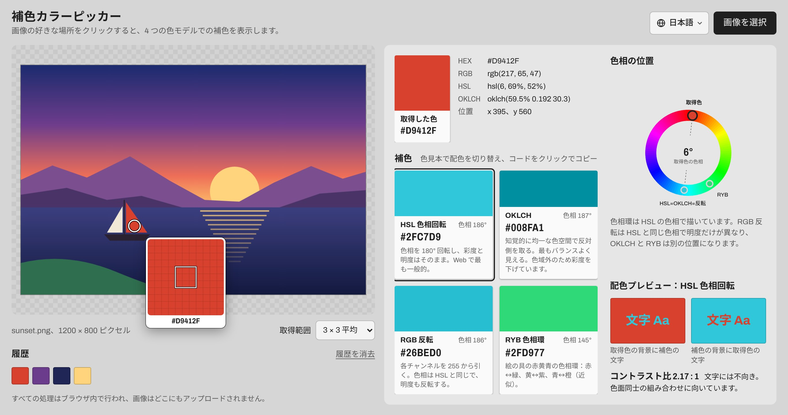
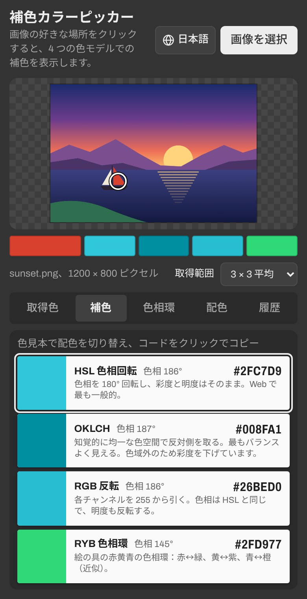

<p align="center">
  <a href="README.md">繁體中文</a> ｜
  <a href="README.zh-Hans.md">简体中文</a> ｜
  <a href="README.en.md">English</a> ｜
  <b>日本語</b>
</p>

<h1 align="center">補色カラーピッカー</h1>

<p align="center">
  画像を読み込んで好きな色をクリックするだけで、その補色がすぐにわかります。<br>
  インストールも登録も不要。パソコンでもスマホでも、ページを開けばすぐに使えます。
</p>

<p align="center">
  <a href="https://remon2208.github.io/complementary-color-picker/?lang=ja">
    
  </a>
</p>

<p align="center">
  URL：<a href="https://remon2208.github.io/complementary-color-picker/?lang=ja"><b>https://remon2208.github.io/complementary-color-picker/</b></a>
</p>

<p align="center">
  <a href="https://remon2208.github.io/complementary-color-picker/?lang=ja">
    <picture>
      <source media="(prefers-color-scheme: dark)" srcset="docs/ja/dark.jpg">
      
    </picture>
  </a>
</p>

## 使い方

1. 上の URL を開きます
2. 右上の「画像を選択」を押すか、画像をページにドラッグします。スクリーンショットをコピーして Ctrl+V（Mac は ⌘V）で貼り付けることもできます
3. 画像の中の好きな色をクリックすると、その補色が横に表示されます
4. カラーコード（例：`#2FC7D9`）をクリックするとコピーされるので、デザインツールやコードにそのまま貼り付けられます



**ヒント**

- 画像の上にマウスを乗せるとルーペが表示され、1 ピクセル単位で狙えます
- 色のばらつきが大きい写真では、「取得範囲」を 5 × 5 か 9 × 9 平均にすると色が安定します
- マウスを押したまま画像の上をドラッグすると、動かしながら結果を確認できます
- 取得した色は「履歴」に残り、クリックで呼び出せます
- スマホでは結果をタブで切り替えます：取得色・補色・色相環・配色・履歴
- 右上で言語を切り替えられます（繁體中文・简体中文・English・日本語）。選んだ言語は次回も記憶されます

## 4 種類の補色の違い

4 つの方法で同時に補色を計算するので、目的に合ったものを選べます：

| 方法 | 向いている用途 |
| --- | --- |
| **HSL 色相回転** | Web サイトやアプリの画面デザインで最も一般的な補色 |
| **OKLCH** | 2 色の見た目の重さをそろえたいとき |
| **RGB 反転** | 明暗まで反転した強いコントラストが欲しいとき |
| **RYB 色相環** | 絵画や絵の具で習う配色：赤と緑、黄と紫、青と橙 |

下の「配色プレビュー」では 2 色を並べて表示し、文字色として使えるだけのコントラストがあるかを確認できます。

<br clear="right">

## よくある質問

**画像はどこかにアップロードされますか？**
いいえ。すべての処理はお使いのブラウザ内で行われ、画像がパソコンやスマホの外に出ることはありません。

**iPhone の写真が開けません。**
iPhone 標準の HEIC 形式は Safari でしか読み込めません。ほかのブラウザでは、JPG か PNG に変換してからお使いください。

**取得した色が画像編集ソフトの数値と少し違います。**
ページで取得されるのは、ブラウザが一般的な画面の色（sRGB）に変換した後の値です。iPhone などで撮影した広色域の写真では、わずかな差が出ることがあります。

**グレー・黒・白に補色がないのはなぜですか？**
これらの色には色相がないため、本当の補色はありません。その場合はページに説明が表示されます。

**古い画面のまま変わりません。**
Ctrl+F5（Mac は ⌘ + Shift + R）で強制的に再読み込みしてください。

---

<details>
<summary><b>開発者向け：仕組みと自分でデプロイする方法</b></summary>

### 概要

HTML・CSS・JavaScript だけで作られていて、パッケージもビルドも不要です。`index.html` をブラウザで開けばローカルで動きます。

```
├── index.html          ページの構造
├── style.css           スタイル
├── color.js            補色のアルゴリズム（DOM に依存せず Node.js でも使用可能）
├── i18n.js             画面の文字と言語切り替え（繁中・简中・English・日本語）
├── app.js              画面の処理：画像の読み込み、色の取得、ルーペ、結果の表示
├── docs/               README 用のスクリーンショット（言語ごとのフォルダ）
└── tests/
    ├── color.test.js   アルゴリズムのテスト
    └── i18n.test.js    翻訳のチェック：全言語の文字列がそろい、パラメータが一致しているか
```

### アルゴリズム

| 方法 | 計算方法 |
| --- | --- |
| HSL 色相回転 | 色相を +180°、彩度と明度はそのまま |
| OKLCH | OKLab 色空間で a と b の符号を反転（色相 +180° と同じ）、明度はそのまま |
| RGB 反転 | 各チャンネルを `255 − 値` に。色相は HSL と同じで、明度も反転 |
| RYB 色相環 | RGB の色相を赤黄青の色相環に区分的に対応させ、180° 回してから戻す（近似値） |

HSL 色相回転には、色空間を変換しない近道があります：

```
新しい値 = max(R, G, B) + min(R, G, B) − 元の値
```

例：`#3366CC` → `#CC9933`、`#800000` → `#008080`

OKLCH で求めた色は、sRGB の画面で表示できる範囲を超えることがあります。その場合は二分探索で彩度を下げて範囲内に収め、色見本にその旨を表示します。

`color.js` はほかのプロジェクトでも単体で使えます：

```js
const ColorMath = require('./color.js');   // ブラウザではグローバル変数 ColorMath

const rgb = ColorMath.hexToRgb('#3366CC');
ColorMath.rgbToHex(ColorMath.complementHsl(rgb));    // '#CC9933'
ColorMath.rgbToHex(ColorMath.complementOklch(rgb));
ColorMath.rgbToHex(ColorMath.complementInvert(rgb));
ColorMath.rgbToHex(ColorMath.complementRyb(rgb));
```

### 言語

ページはブラウザの言語に合わせて表示言語を選び、対応していない言語の場合は英語で表示します。URL に `?lang=` を付けて指定することもできます：

| 言語 | URL パラメータ |
| --- | --- |
| 繁體中文 | `?lang=zh-Hant`（または `zh-TW`） |
| 简体中文 | `?lang=zh-Hans`（または `zh-CN`） |
| English | `?lang=en` |
| 日本語 | `?lang=ja` |

画面の文字はすべて `i18n.js` にあります。言語を追加するには、`LANGS` に 1 件追加し、文字列表をコピーして翻訳します。

### テスト

Node.js 18 以上が必要です：

```bash
node --test
```

既知の色の結果、HSL の近道と通常の変換の比較、OKLCH 補色の明度と色相、RYB 色相の対応が往復で一致するか、そして 4 言語すべての文字列がそろっているかをテストします。

### 自分でデプロイする

1. このページ右上の **Fork** を押して、自分のアカウントにコピーします
2. **Settings → Pages** で **Source** を **Deploy from a branch** にし、Branch は `main`、フォルダは `/ (root)` を選んで **Save** を押します
3. 1〜2 分待つと、`https://ユーザー名.github.io/complementary-color-picker/` で公開されます

### 制限

- 約 1,600 万ピクセルを超える画像は、スマホのブラウザがメモリ不足にならないよう、縮小してから色を取得します。

</details>
