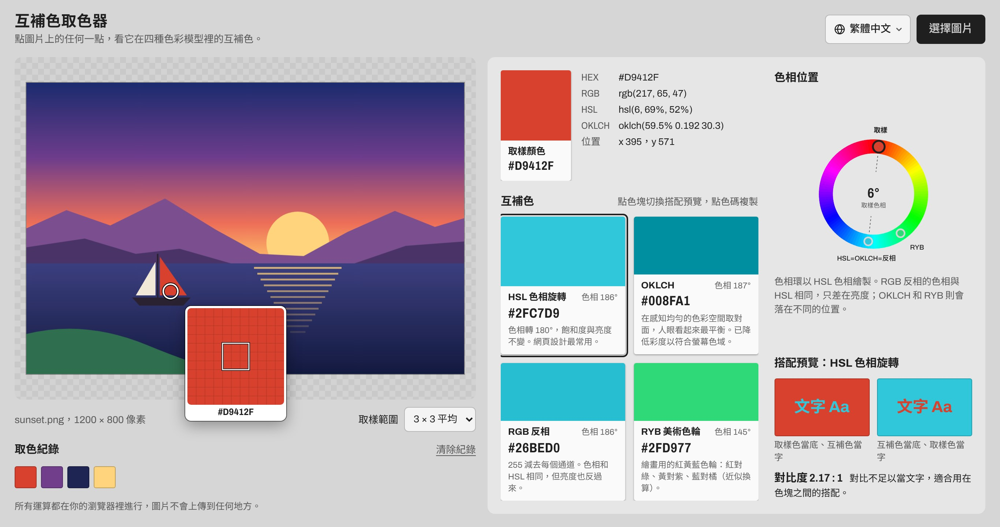
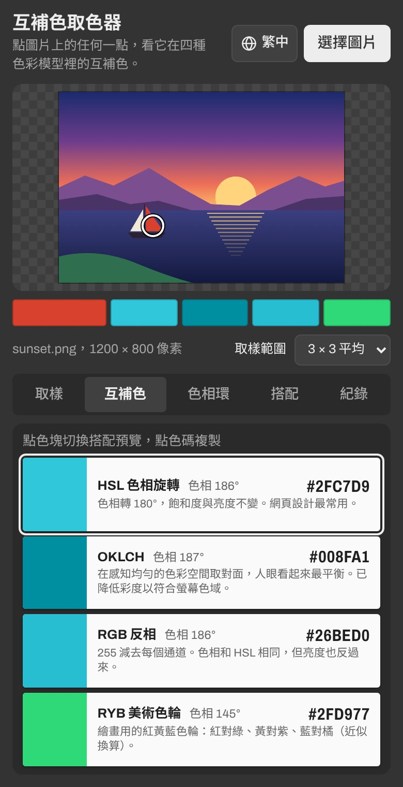

<h1 align="center">互補色取色器</h1>

<p align="center">
  上傳一張圖片，點一下想要的顏色，馬上算出它的互補色。<br>
  免安裝、免註冊，電腦和手機打開網頁就能用。
</p>

<p align="center">
  <a href="https://remon2208.github.io/complementary-color-picker/">
    
  </a>
</p>

<p align="center">
  網址：<a href="https://remon2208.github.io/complementary-color-picker/"><b>https://remon2208.github.io/complementary-color-picker/</b></a>
</p>

<p align="center">
  <a href="https://remon2208.github.io/complementary-color-picker/?lang=zh-Hant">繁體中文</a> ｜
  <a href="https://remon2208.github.io/complementary-color-picker/?lang=zh-Hans">简体中文</a> ｜
  <a href="https://remon2208.github.io/complementary-color-picker/?lang=en">English</a> ｜
  <a href="https://remon2208.github.io/complementary-color-picker/?lang=ja">日本語</a>
</p>

<p align="center">
  <a href="https://remon2208.github.io/complementary-color-picker/">
    <picture>
      <source media="(prefers-color-scheme: dark)" srcset="docs/screenshot-dark.jpg">
      
    </picture>
  </a>
</p>

## 怎麼用

1. 打開上面的網址
2. 按右上角的「選擇圖片」，也可以把圖片直接拖進網頁，或複製截圖後按 Ctrl+V（Mac 是 ⌘V）貼上
3. 在圖片上點你想要的顏色，旁邊就會出現它的互補色
4. 點色碼（例如 `#2FC7D9`）就會複製，可以直接貼到繪圖軟體或網頁程式裡



**小技巧**

- 滑鼠移到圖片上會出現放大鏡，方便對準單一像素
- 照片的顏色比較雜時，把「取樣範圍」改成 5 × 5 或 9 × 9 平均，取到的顏色會比較穩定
- 按住滑鼠在圖片上拖曳，可以一邊移動一邊看結果
- 取過的顏色會留在「取色紀錄」，點一下就能叫回來
- 手機上的結果用分頁切換：取樣、互補色、色相環、搭配、紀錄
- 右上角可以切換語言，選過的語言下次打開會記住

## 四種互補色差在哪

網頁會同時用四種方法算互補色，你可以挑最適合的那一個：

| 方法 | 適合用在 |
| --- | --- |
| **HSL 色相旋轉** | 網頁、App 介面設計最常用的互補色 |
| **OKLCH** | 想讓兩個顏色看起來份量最平衡時 |
| **RGB 反相** | 需要連明暗都相反的強烈對比 |
| **RYB 美術色輪** | 畫畫、調顏料時學的配法：紅配綠、黃配紫、藍配橘 |

下方的「搭配預覽」會把兩個顏色放在一起，並告訴你對比度夠不夠拿來當文字顏色。

<br clear="right">

## 常見問題

**圖片會被上傳到網路上嗎？**
不會。所有運算都在你自己的瀏覽器裡進行，圖片不會離開你的電腦或手機。

**iPhone 的照片打不開？**
iPhone 預設的 HEIC 格式只有 Safari 能讀。用其他瀏覽器的話，請先把照片轉成 JPG 或 PNG。

**取到的顏色跟修圖軟體裡的數字差一點？**
網頁取到的是瀏覽器轉成一般螢幕色彩（sRGB）後的值。iPhone 等裝置拍的廣色域照片，數字可能會有些微差異。

**灰色、黑色、白色怎麼沒有互補色？**
這些顏色沒有色相，所以沒有真正的互補色，網頁會顯示提示。

**看到的還是舊版畫面？**
按 Ctrl+F5（Mac 是 ⌘ + Shift + R）強制重新整理。

---

<details>
<summary><b>給開發者：程式說明、自己部署一份</b></summary>

### 技術概要

純 HTML、CSS、JavaScript，沒有任何套件或建置步驟。直接用瀏覽器打開 `index.html` 就能在本機執行。

```
├── index.html          頁面結構
├── style.css           樣式
├── color.js            互補色演算法（不依賴網頁，可單獨在 Node.js 使用）
├── i18n.js             介面文字與語言切換（繁中、简中、English、日本語）
├── app.js              介面邏輯：載入圖片、取色、放大鏡、顯示結果
├── docs/               README 用的截圖
└── tests/
    ├── color.test.js   演算法測試
    └── i18n.test.js    翻譯檢查：每種語言的字串都齊全、參數一致
```

### 演算法

| 方法 | 做法 |
| --- | --- |
| HSL 色相旋轉 | 色相 +180°，飽和度與亮度不變 |
| OKLCH | 在 OKLab 色彩空間把 a、b 取負號（等同色相 +180°），亮度不變 |
| RGB 反相 | 每個通道 `255 − 值`，色相與 HSL 相同但亮度也反轉 |
| RYB 美術色輪 | 把 RGB 色相分段對應到紅黃藍色輪，轉 180° 再對應回來（近似值） |

HSL 色相旋轉有一個不用轉換色彩空間的捷徑：

```
新值 = max(R, G, B) + min(R, G, B) − 原值
```

例如 `#3366CC` → `#CC9933`，`#800000` → `#008080`。

OKLCH 算出的顏色有時會超出 sRGB 螢幕能顯示的範圍，這時程式會用二分法降低彩度，直到顏色落在範圍內，並在色票上註明。

`color.js` 也可以在其他專案裡單獨使用：

```js
const ColorMath = require('./color.js');   // 瀏覽器裡則是全域變數 ColorMath

const rgb = ColorMath.hexToRgb('#3366CC');
ColorMath.rgbToHex(ColorMath.complementHsl(rgb));    // '#CC9933'
ColorMath.rgbToHex(ColorMath.complementOklch(rgb));
ColorMath.rgbToHex(ColorMath.complementInvert(rgb));
ColorMath.rgbToHex(ColorMath.complementRyb(rgb));
```

### 語言

網頁依照瀏覽器語言自動選擇介面語言，不支援的語言顯示英文。也可以在網址加上 `?lang=` 指定：

| 語言 | 網址參數 |
| --- | --- |
| 繁體中文 | `?lang=zh-Hant`（或 `zh-TW`） |
| 简体中文 | `?lang=zh-Hans`（或 `zh-CN`） |
| English | `?lang=en` |
| 日本語 | `?lang=ja` |

所有介面文字都在 `i18n.js`。要新增語言，在 `LANGS` 加一筆，再複製一份字串表翻譯即可。

### 測試

需要 Node.js 18 以上：

```bash
node --test
```

測試內容包含已知顏色的結果、HSL 捷徑公式與完整轉換的比對、OKLCH 互補色的亮度與色相檢查、RYB 色相對應能否來回轉換，以及四種語言的字串是否齊全。

### 自己部署一份

1. 按這個頁面右上角的 **Fork**，複製一份到自己的帳號
2. 到 **Settings → Pages**，**Source** 選 **Deploy from a branch**，Branch 選 `main`、資料夾選 `/ (root)`，按 **Save**
3. 等一兩分鐘，網址會是 `https://你的帳號.github.io/complementary-color-picker/`

### 限制

- 超過約 1,600 萬像素的圖片會先縮小再取色，避免手機瀏覽器記憶體不足。

</details>
