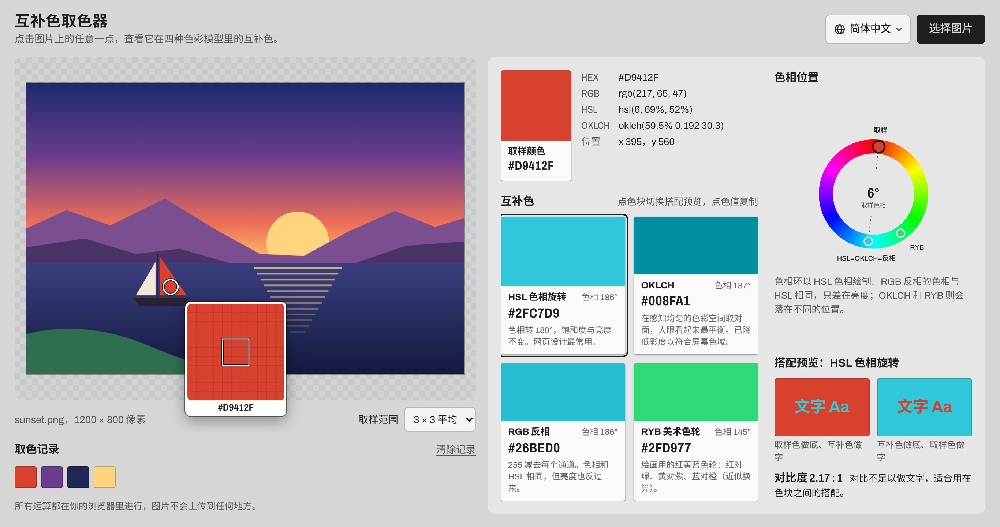
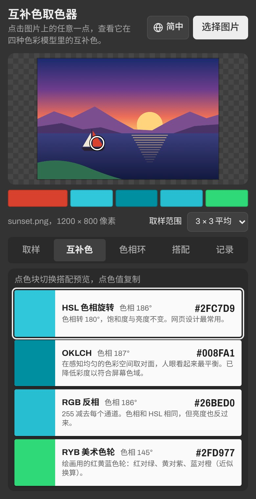

<p align="center">
  <a href="README.md">繁體中文</a> ｜
  <b>简体中文</b> ｜
  <a href="README.en.md">English</a> ｜
  <a href="README.ja.md">日本語</a>
</p>

<h1 align="center">互补色取色器</h1>

<p align="center">
  上传一张图片，点一下想要的颜色，马上算出它的互补色。<br>
  无需安装、无需注册，电脑和手机打开网页就能用。
</p>

<p align="center">
  <a href="https://remon2208.github.io/complementary-color-picker/?lang=zh-Hans">
    
  </a>
</p>

<p align="center">
  网址：<a href="https://remon2208.github.io/complementary-color-picker/?lang=zh-Hans"><b>https://remon2208.github.io/complementary-color-picker/</b></a>
</p>

<p align="center">
  <a href="https://remon2208.github.io/complementary-color-picker/?lang=zh-Hans">
    <picture>
      <source media="(prefers-color-scheme: dark)" srcset="docs/zh-Hans/dark.jpg">
      
    </picture>
  </a>
</p>

## 怎么用

1. 打开上面的网址
2. 点右上角的“选择图片”，也可以把图片直接拖进网页，或者复制截图后按 Ctrl+V（Mac 是 ⌘V）粘贴
3. 在图片上点你想要的颜色，旁边就会出现它的互补色
4. 点色值（例如 `#2FC7D9`）就会复制，可以直接粘贴到绘图软件或网页代码里



**小技巧**

- 鼠标移到图片上会出现放大镜，方便对准单个像素
- 照片的颜色比较杂时，把“取样范围”改成 5 × 5 或 9 × 9 平均，取到的颜色会更稳定
- 按住鼠标在图片上拖动，可以一边移动一边看结果
- 取过的颜色会留在“取色记录”里，点一下就能调回来
- 手机上的结果用标签页切换：取样、互补色、色相环、搭配、记录
- 右上角可以切换语言（繁體中文、简体中文、English、日本語），选过的语言下次打开会记住

## 四种互补色有什么不同

网页会同时用四种方法算互补色，你可以挑最合适的那一个：

| 方法 | 适合用在 |
| --- | --- |
| **HSL 色相旋转** | 网页、App 界面设计最常用的互补色 |
| **OKLCH** | 想让两个颜色看起来分量最平衡时 |
| **RGB 反相** | 需要连明暗都相反的强烈对比 |
| **RYB 美术色轮** | 画画、调颜料时学的配法：红配绿、黄配紫、蓝配橙 |

下方的“搭配预览”会把两个颜色放在一起，并告诉你对比度够不够用作文字颜色。

<br clear="right">

## 常见问题

**图片会被上传到网上吗？**
不会。所有运算都在你自己的浏览器里进行，图片不会离开你的电脑或手机。

**iPhone 的照片打不开？**
iPhone 默认的 HEIC 格式只有 Safari 能读取。用其他浏览器的话，请先把照片转成 JPG 或 PNG。

**取到的颜色跟修图软件里的数值差一点？**
网页取到的是浏览器转换成普通屏幕色彩（sRGB）后的值。iPhone 等设备拍的广色域照片，数值可能会有细微差异。

**灰色、黑色、白色怎么没有互补色？**
这些颜色没有色相，所以没有真正的互补色，网页会显示提示。

**看到的还是旧版界面？**
按 Ctrl+F5（Mac 是 ⌘ + Shift + R）强制刷新。

---

<details>
<summary><b>开发者说明：程序结构、自己部署一份</b></summary>

### 技术概要

纯 HTML、CSS、JavaScript，没有任何依赖包或构建步骤。直接用浏览器打开 `index.html` 就能在本地运行。

```
├── index.html          页面结构
├── style.css           样式
├── color.js            互补色算法（不依赖网页，可单独在 Node.js 使用）
├── i18n.js             界面文字与语言切换（繁中、简中、English、日本語）
├── app.js              界面逻辑：加载图片、取色、放大镜、显示结果
├── docs/               README 用的截图（每种语言一个文件夹）
└── tests/
    ├── color.test.js   算法测试
    └── i18n.test.js    翻译检查：每种语言的字符串都齐全、参数一致
```

### 算法

| 方法 | 做法 |
| --- | --- |
| HSL 色相旋转 | 色相 +180°，饱和度与亮度不变 |
| OKLCH | 在 OKLab 色彩空间把 a、b 取负号（等同色相 +180°），亮度不变 |
| RGB 反相 | 每个通道 `255 − 值`，色相与 HSL 相同但亮度也反转 |
| RYB 美术色轮 | 把 RGB 色相分段映射到红黄蓝色轮，转 180° 再映射回来（近似值） |

HSL 色相旋转有一个不用转换色彩空间的捷径：

```
新值 = max(R, G, B) + min(R, G, B) − 原值
```

例如 `#3366CC` → `#CC9933`，`#800000` → `#008080`。

OKLCH 算出的颜色有时会超出 sRGB 屏幕能显示的范围，这时程序会用二分法降低彩度，直到颜色落在范围内，并在色卡上注明。

`color.js` 也可以在其他项目里单独使用：

```js
const ColorMath = require('./color.js');   // 在浏览器里则是全局变量 ColorMath

const rgb = ColorMath.hexToRgb('#3366CC');
ColorMath.rgbToHex(ColorMath.complementHsl(rgb));    // '#CC9933'
ColorMath.rgbToHex(ColorMath.complementOklch(rgb));
ColorMath.rgbToHex(ColorMath.complementInvert(rgb));
ColorMath.rgbToHex(ColorMath.complementRyb(rgb));
```

### 语言

网页根据浏览器语言自动选择界面语言，不支持的语言显示英文。也可以在网址后加上 `?lang=` 指定：

| 语言 | 网址参数 |
| --- | --- |
| 繁體中文 | `?lang=zh-Hant`（或 `zh-TW`） |
| 简体中文 | `?lang=zh-Hans`（或 `zh-CN`） |
| English | `?lang=en` |
| 日本語 | `?lang=ja` |

所有界面文字都在 `i18n.js`。要新增语言，在 `LANGS` 加一项，再复制一份字符串表翻译即可。

### 测试

需要 Node.js 18 以上：

```bash
node --test
```

测试内容包括已知颜色的结果、HSL 捷径公式与完整转换的比对、OKLCH 互补色的亮度与色相检查、RYB 色相映射能否来回转换，以及四种语言的字符串是否齐全。

### 自己部署一份

1. 点这个页面右上角的 **Fork**，复制一份到自己的账号
2. 进入 **Settings → Pages**，**Source** 选 **Deploy from a branch**，Branch 选 `main`、文件夹选 `/ (root)`，点 **Save**
3. 等一两分钟，网址会是 `https://你的账号.github.io/complementary-color-picker/`

### 限制

- 超过约 1,600 万像素的图片会先缩小再取色，避免手机浏览器内存不足。

</details>
